# Creating HubSpot App

## Overview

To use the HubSpot Marketing Extension, you need to create a HubSpot application that will handle OAuth authentication and API access. This guide walks you through the complete process of creating and configuring your HubSpot app.

## Prerequisites

Before creating a HubSpot app, ensure you have:

1. **HubSpot Account** with admin access
2. **HubSpot Developer Account** (free to create)
3. **Marketing Hub Access** (required for marketing features)
4. **Understanding of OAuth 2.0** (basic knowledge helpful)

## Step-by-Step App Creation

### Step 1: Access HubSpot Developer Portal

1. **Navigate to Developer Portal**
   - Go to [HubSpot Developer Portal](https://developers.hubspot.com/)
   - Sign in with your HubSpot credentials

2. **Access Apps Section**
   - Select **Developement-> Legacy Apps** in the main navigation
   - You'll see your existing apps (if any) or an empty list

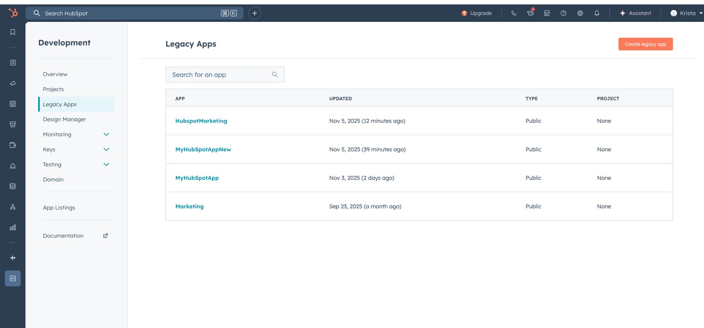

### Step 2: Create New App

1. **Start App Creation**
   - Click **Create legacy app** button
   - You'll be taken to the app creation wizard

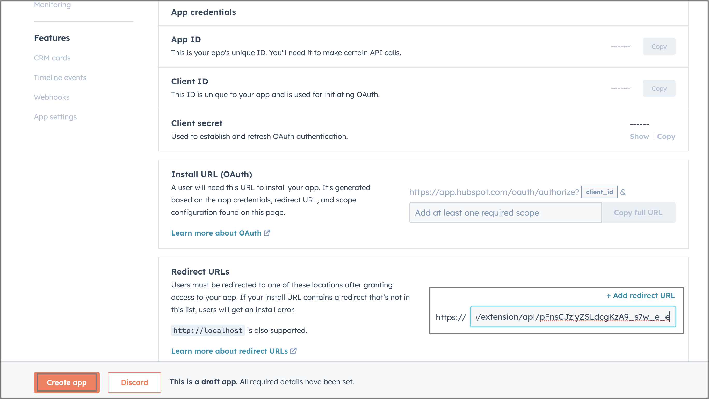

2. **Choose App Type**
   - Select **Public app** for most use cases
   - Private apps are for internal use only
   - Public apps can be used across multiple HubSpot accounts

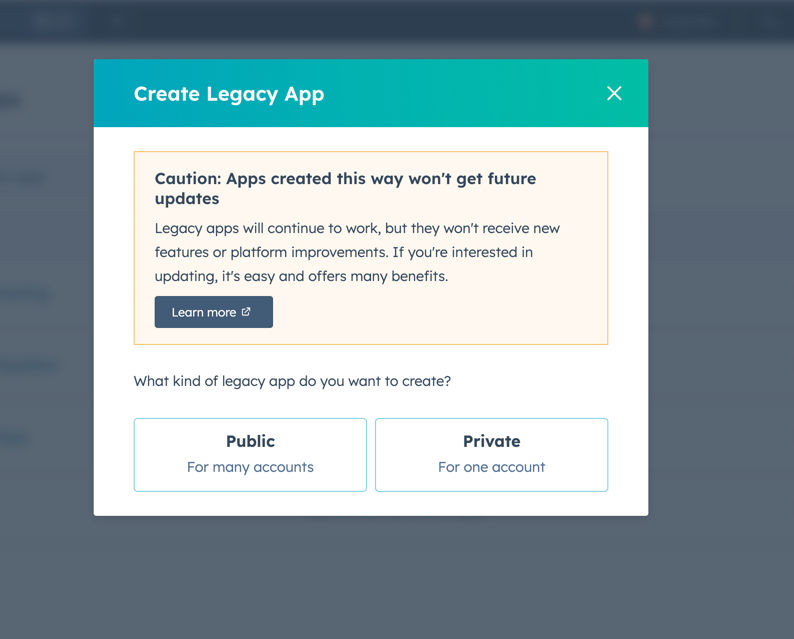

### Step 3: Configure Basic App Information

1. **App Details Tab**
   - **App name**: Enter a descriptive name (e.g., "Marketing Automation App")
   - **Description**: Describe your app's purpose
   - **Logo**: Upload a logo (optional but recommended)
   - **Website URL**: Your company or app website

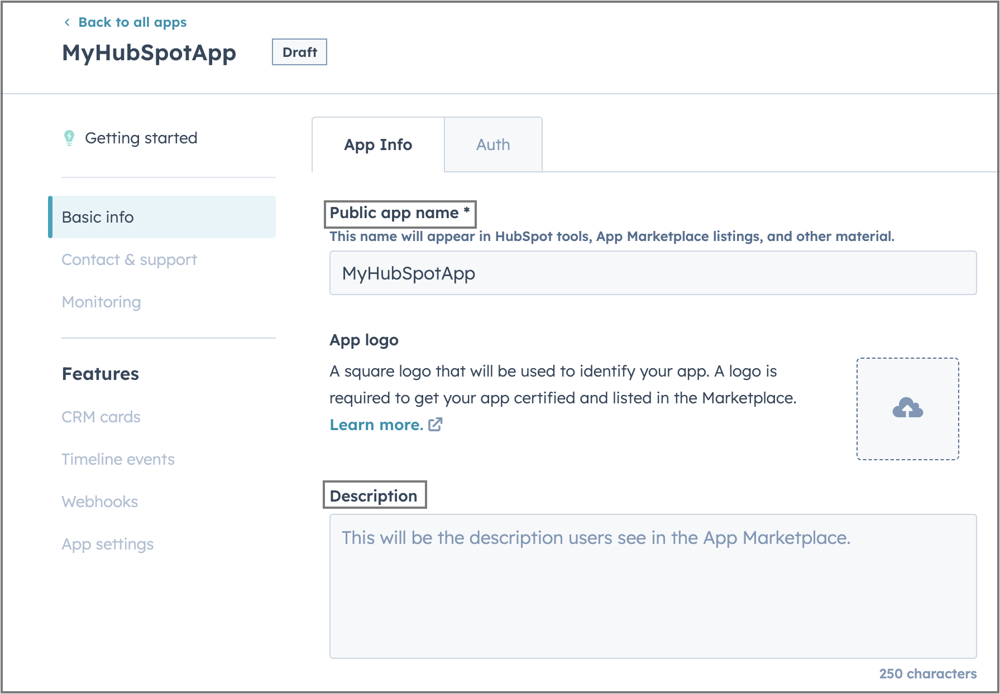

2. **Save Basic Information**
   - Click **Save** to proceed to the next step
   - You can always return to modify these details later

### Step 4: Configure Authentication

1. **Navigate to Auth Tab**
   - Click on the **Auth** tab in your app settings
   - This is where you'll configure OAuth settings

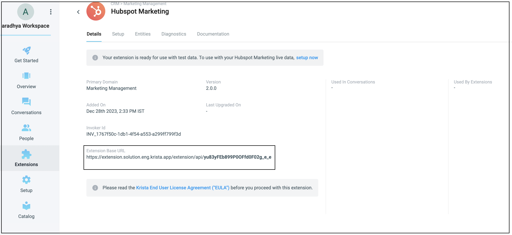

2. **Set Redirect URI**
   - **Copy Extension Base URL** from Krista extension setup
   - **Add callback path**: Append `/hsmarketing/callback` to the base URL
   - **Example**: `https://your-krista-instance.com/extensions/hsmarketing/callback`
   - **Paste complete URL** into the Redirect URI field

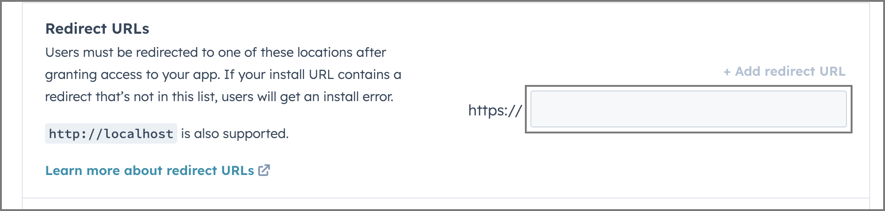

### Step 5: Configure Required Scopes

The HubSpot Marketing Extension requires specific OAuth scopes for proper functionality:

1. **Select Required Scopes**
   - Navigate to the **Scopes** section in the Auth tab
   - Select the following scopes:
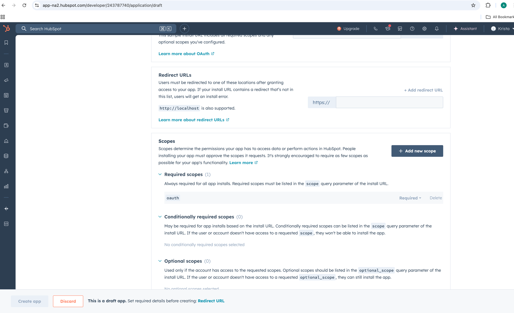
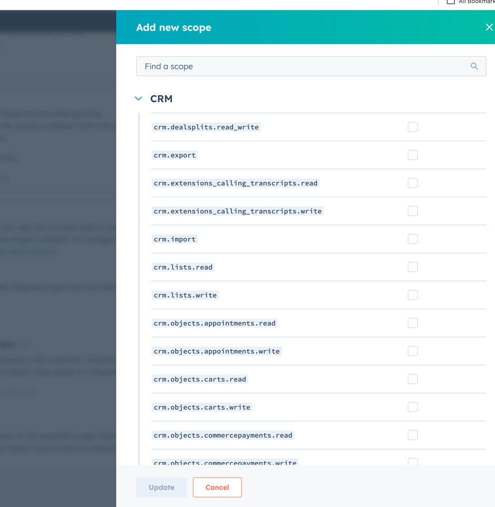

#### Required Scopes for Marketing Extension

| Scope | Purpose | Required |
|-------|---------|----------|
| `content` | Access to marketing content (emails, templates) | Yes |
| `communication_preferences.read` | Read communication preferences and subscriptions | Yes |
| `communication_preferences.read_write` | Manage communication preferences and subscriptions | Yes |
| `communication_preferences.write` | Update communication preferences and subscriptions | Yes |
| `settings.users.read` | Read user settings and context | Yes |
| `crm.objects.contacts.read` | Read contact information for targeting | Yes |

2. **Scope Descriptions**
   - **content**: Enables creation, reading, updating, and deletion of marketing emails and templates
   - **communication_preferences.read**: Allows reading subscription preferences and communication settings
   - **communication_preferences.read_write**: Enables managing subscription preferences and communication settings
   - **communication_preferences.write**: Allows updating subscription preferences and communication settings
   - **settings.users.read**: Provides user context and settings information
   - **crm.objects.contacts.read**: Allows reading contact data for email personalization and targeting

3. **Save Scope Configuration**
   - Ensure all required scopes are selected
   - Click **Save** to apply the scope configuration

### Step 6: Create Developers Test Account
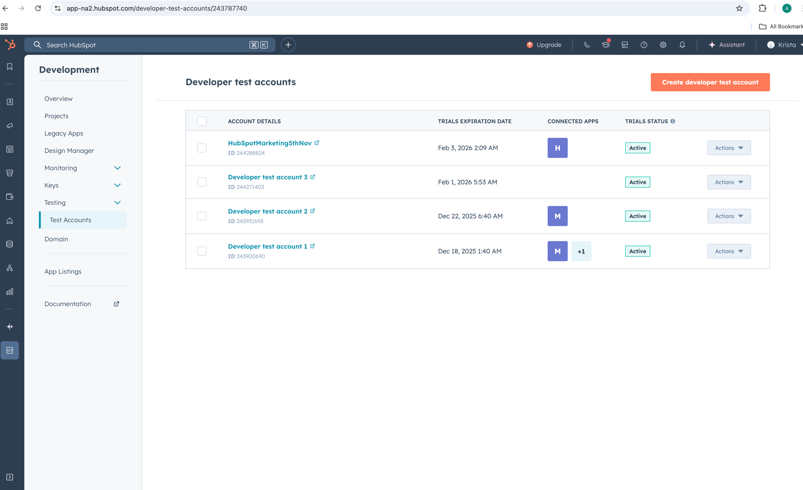

### Step 7: Obtain App Credentials

1. **Copy Client ID**
   - Go to **Auth** tab
   - Copy the **Client ID** - this is your Client ID
   - Save this value for Krista configuration

2. **Copy Client Secret**
   - Go to **Auth** tab
   - Copy the **Client secret**
   - **Important**: Keep this secret secure and never expose it publicly
   - Save this value for Krista configuration

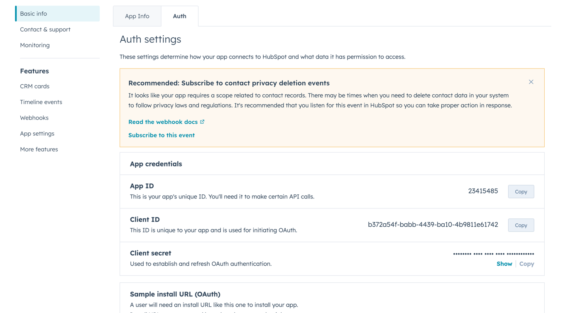

### Step 8: Install URL Configuration (Optional)

If you want users to easily install your app:

1. **Configure Install URL**
   - Go to **App Info** tab
   - Set the **Install URL** if you want a custom installation flow
   - For most cases, the default OAuth flow is sufficient

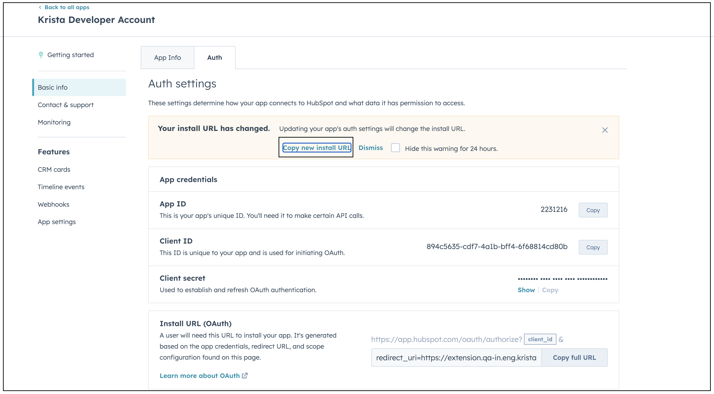

### Step 9: Test Your App

1. **Create Test Account**
   - Use HubSpot's test account feature for development
   - Go to your HubSpot account settings
   - Create or access a test account

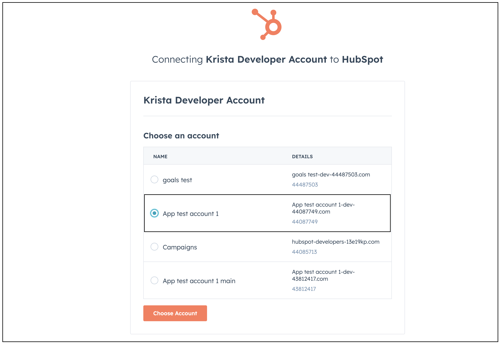

2. **Test OAuth Flow**
   - Use the test account to verify OAuth authentication
   - Ensure all scopes are properly requested and granted
   - Verify redirect URI works correctly

### Step 9: App Review and Publishing

1. **Review App Settings**
   - Double-check all configuration settings
   - Verify redirect URIs are correct
   - Confirm all required scopes are selected

2. **App Status**
   - **Draft**: App is in development, limited functionality
   - **Published**: App is ready for production use
   - **Under Review**: App is being reviewed by HubSpot (for marketplace)

3. **Publish Your App**
   - Click **Publish** when ready for production
   - Published apps have full OAuth functionality
   - Draft apps have limitations and shorter token lifetimes

## App Configuration Checklist

Before using your app with the Krista extension, verify:

- [ ] App is created and configured
- [ ] Redirect URI matches Krista extension URL exactly
- [ ] All required scopes are selected and saved
- [ ] Client ID and Client Secret are copied
- [ ] App is published (not in draft mode)
- [ ] Test OAuth flow works correctly
- [ ] User has appropriate permissions in HubSpot

## Security Best Practices

### Client Secret Management
- **Never commit** Client Secret to version control
- **Store securely** in environment variables or secure vaults
- **Rotate periodically** for enhanced security
- **Limit access** to only necessary personnel

### Redirect URI Security
- **Use HTTPS** for all redirect URIs in production
- **Exact matching** - HubSpot requires exact URI matches
- **No wildcards** - Partial matching is not supported
- **Validate domains** - Ensure URIs point to your controlled domains

### Scope Minimization
- **Request only necessary scopes** for your use case
- **Review scope descriptions** to understand permissions
- **Document scope usage** for compliance and auditing
- **Regular scope audits** to remove unused permissions

## Troubleshooting App Creation

### Common App Creation Issues

#### "Redirect URI is invalid"
**Cause**: URI format or protocol issues
**Resolution**:
1. Ensure URI uses HTTPS (required for production)
2. Verify exact path matches Krista extension URL
3. Check for typos or extra characters
4. Confirm domain is accessible

#### "Scope not available"
**Cause**: Account limitations or scope restrictions
**Resolution**:
1. Verify HubSpot subscription includes required features
2. Check account permissions for scope access
3. Contact HubSpot support for scope availability
4. Review HubSpot documentation for scope requirements

#### "App creation failed"
**Cause**: Various validation or system issues
**Resolution**:
1. Check all required fields are completed
2. Verify account has developer access
3. Try creating app with different name
4. Contact HubSpot developer support

### App Management Tips

1. **Regular Monitoring**
   - Monitor app usage and performance
   - Review OAuth success/failure rates
   - Check for API rate limit issues

2. **Documentation**
   - Document app configuration for team reference
   - Maintain changelog of app modifications
   - Keep credentials inventory updated

3. **Backup Configuration**
   - Export app settings for backup
   - Document all configuration parameters
   - Maintain disaster recovery procedures

## Next Steps

After successfully creating your HubSpot app:

1. **Configure Extension**: Follow the [Extension Configuration](pages/ExtensionConfiguration.md) guide
2. **Complete Authentication**: Review the [Authentication](pages/Authentication.md) process
3. **Test Functionality**: Try your first [Email Entity](pages/EmailEntity.md) operations

## Troubleshooting

### Common App Creation Issues

If you encounter problems:
- Verify all required fields are completed correctly
- Check that redirect URI exactly matches your Krista extension URL
- Ensure your HubSpot account has the necessary permissions
- Contact HubSpot support if issues persist

## See Also

- [Extension Configuration](pages/ExtensionConfiguration.md) - Next step after app creation
- [Authentication](pages/Authentication.md) - Understanding OAuth flow
- [HubSpot Developer Documentation](https://developers.hubspot.com/) - Official HubSpot resources
